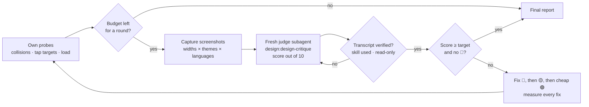

# UI/UX Review Judge

[](https://github.com/JanGradkowski/ui-ux-review-judge/actions/workflows/test.yml)
[](LICENSE)

**A Claude Code skill that keeps polishing a page until an honest judge gives it 9/10.**

Claude can't grade its own homework: it wrote the fixes, so it sees them kindly. This skill splits the work in two.

- **Claude fixes** the page.
- **A fresh, read-only judge subagent scores it** out of 10 each round, using Anthropic's [`design:design-critique`](https://github.com/anthropics/knowledge-work-plugins/tree/main/design) framework.

Before a score counts, the skill reads the judge's transcript to prove it really used that framework and changed nothing. The loop runs until the target score, the usage budget, or the user's own stop rule.

```text
> Rate the dashboard out of 10 and keep fixing it until a judge gives it 9/10, or the 5-hour limit runs out.
```

## How a round works



1. **Pre-flight probes.** Before paying for a judge, Claude runs its own checks. At ten widths and in every language, they look for overlapping or spilling text and sideways scroll, and they confirm every tap lands on the control it was meant for. A judge round costs about 10% of a Claude Pro 5-hour window; a probe costs nothing.
2. **Fresh screenshots** of the whole matrix: desktop, tablet and phone, light and dark, every language, plus states like open menus, the skip link and keyboard focus.
3. **A new judge every round.** It never sees earlier scores. It gets the previous findings to re-check, plus the "deliberate choices" Claude won't change, each with its reason. Fixed scoring anchors keep different judges on the same scale; for example, any open 🔴 caps the score at 7.
4. **Verification.** `verify_judge.py` reads the judge's transcript. A round doesn't count unless `design:design-critique` was invoked before the first screenshot was opened. Writes, sign-ins, form submissions and non-GET requests are flagged.
5. **Fixes with evidence.** Claude reproduces each finding with a measurement before fixing it, and can try CSS with `--css` before touching a file. When two judges contradict each other, it picks one convention and records why, instead of flip-flopping.

## What to expect

On a real signed-in dashboard, ten verified rounds went:

```text
5.5 → 7.3 → 7.3 → 8.2 → 7.0 → 8.2 → 8.3 → 8.0 → 8.3 → 8.0
```

That page never reached 9. That's the point: a fresh judge doesn't round up or remember the hard work. Once the big problems are gone, each new judge finds new nitpicks, so scores plateau around 8. The skill tells you when that happens, and only keeps going if you said "until 9/10 or the limit".

The drop to 7.0 was a regression the fixes caused: text collisions at mid widths. That's why the pre-flight probes exist.

## Requirements

- [Claude Code](https://docs.claude.com/en/docs/claude-code), or the Claude desktop app's Code tab.
- Anthropic's **`design` plugin**, which provides `design:design-critique`:
  ```text
  /plugin marketplace add anthropics/knowledge-work-plugins
  /plugin install design@knowledge-work-plugins
  ```
- A web app you can run locally, or a test environment, preferably against a review database.
- **Node.js 18+** with [Playwright](https://playwright.dev) in the app's project (`npm i -D playwright`), plus a browser for it: `npx playwright install chromium`, or an installed Edge or Chrome.
- **Python 3.8+** for `verify_judge.py`. It needs no packages.

## Install

Install it as a plugin:

```text
/plugin marketplace add JanGradkowski/ui-ux-review-judge
/plugin install ui-ux-review-judge@ui-ux-review-judge
```

Or copy the skill into your personal skills folder:

```bash
git clone https://github.com/JanGradkowski/ui-ux-review-judge.git
cp -r ui-ux-review-judge/skills/ui-ux-review-judge ~/.claude/skills/
```

Don't do both, or you'll have the skill twice.

## Use

Ask in your own words. The skill also starts on its own when you ask for a design score:

- *"How would you rate the settings page out of 10? Then fix the issues and re-rate."*
- *"Review, fix and re-review /checkout until 9/10. Stop at 80% of my usage window."*
- *"Get an honest critic on the pricing page, three rounds max."*

Or start it directly with `/ui-ux-review-judge`. Installed as a plugin, its name is `/ui-ux-review-judge:ui-ux-review-judge`.

On the first run in a project, Claude:

1. sets up a review server and a signed-in session;
2. writes `review.config.json` for the scripts;
3. saves what it learned to `.claude/ui-ux-review-judge.md` in your project, so the next loop starts in minutes. To keep those notes out of version control, it uses `.claude/ui-ux-review-judge.local.md` instead.

## Safety

The judge runs against a signed-in session, so it is kept on a short leash:

- **Read-only judge.** It may only load pages and do client-side things: focus, hover, keyboard, and opening disclosures. It never signs in, submits forms, sends POST, PUT, PATCH or DELETE requests, or edits project files.
- **Verified, not trusted.** `verify_judge.py` checks the judge's transcript for writes outside its own folder, and for anything that looks like sign-in, form submission, non-GET requests, git, database or package operations.
- **Local sign-in only.** `sign-in.cjs` signs in only to local or `.test` hosts, unless you allow a named test environment. It reads a test account from a local properties file and never prints the values.
- **Review database.** The skill asks for a seeded copy or a separate schema, never a shared database.
- **No surprise commits.** Claude commits, pushes or merges only when you ask.

## Scripts

Every script reads one [`review.config.json`](skills/ui-ux-review-judge/assets/review.config.example.json). The full reference is in [`references/scripts.md`](skills/ui-ux-review-judge/references/scripts.md).

| Script | Purpose |
|---|---|
| `capture.cjs` | The screenshot matrix, with tall pages cut into viewport-sized slices, plus state shots and an index per language |
| `collision-probe.cjs` | Overlapping or spilling text, elements sticking out of their container, sideways page scroll |
| `tap-probe.cjs` | Taps that miss their control, and targets under 24×24px |
| `sign-in.cjs` | One sign-in, saved as Playwright storage state for everything else |
| `verify_judge.py` | The judge's Skill call and its timing, unsafe actions, and the score |

The capture script and both probes take `--css "<rules>"`, so you can try a fix at every width without editing files or restarting the server.

## Repository layout

```text
.claude-plugin/          plugin.json and marketplace.json
skills/ui-ux-review-judge/
  SKILL.md               the loop
  references/            judge brief template, script reference, project notes template
  scripts/               Playwright probes and capture, sign-in, judge verifier
  assets/                example config
test/                    fixture pages and tests for the scripts
```

## Development

```bash
npm install
npx playwright install chromium
npm test
```

The tests serve a clean fixture page and a deliberately broken one. They check that both probes pass the first and catch every planted problem in the second. They also check that `verify_judge.py` accepts a valid judge transcript and rejects or flags bad ones. To use an installed browser instead, set `PW_CHANNEL=msedge` or `PW_CHANNEL=chrome`.

`claude plugin validate .` checks the plugin and marketplace manifests.

## License

[MIT](LICENSE)
